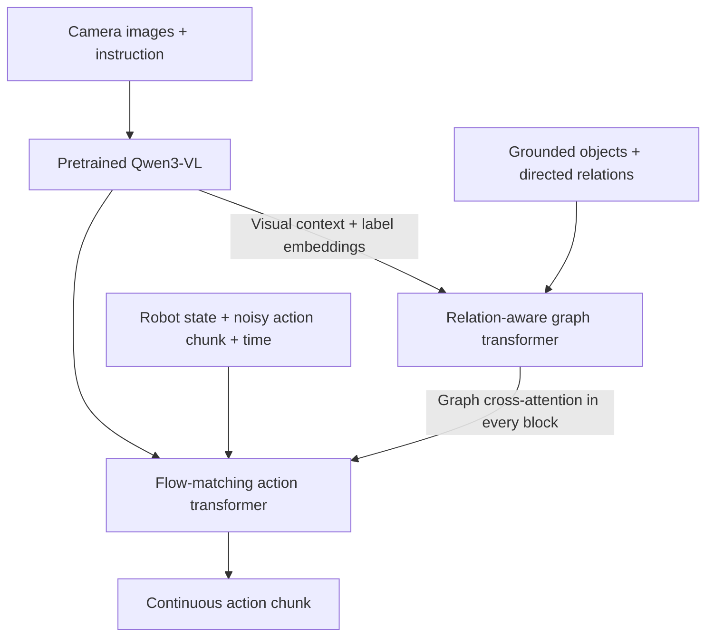

# WISE-VLA

**World-Informed Structured Embodied Vision-Language-Action** — a PyTorch policy for Grounded Forge.

WISE-VLA combines a **pretrained Qwen3-VL** vision-language backbone, a **typed, directed knowledge-graph transformer**, and a **continuous flow-matching action expert**. The action expert and graph layers are implemented here from scratch. No pretrained VLA policy is wrapped or reused.

This repository contains a trainable research implementation, a complete dataset-to-inference workflow, tests, and a runnable CPU demo. **It does not contain trained robot-policy weights or measured robot success rates.** The offline `tiny` backbone is randomly initialized and exists for software validation only.

## Architecture



- Multi-camera RGB and language are encoded by Qwen3-VL. Its weights are frozen by default.
- Nodes carry geometry, object type, confidence, age, a bounding box, and semantic label embeddings from the VLM's token embedding table.
- Each graph block uses forward/reverse relation attention biases, typed relation messages, and visual cross-attention. Multiple predicates can connect the same ordered pair.
- Every action block directly cross-attends to graph tokens and VLM tokens. Action attention uses RoPE, QK normalization, RMSNorm, SwiGLU, and time/state conditioning with adaptive modulation.
- Training combines masked conditional flow matching, masked relation reconstruction, and optional target-object supervision.
- Inference encodes the observation once per chunk and integrates the velocity field with Euler or Heun steps. A policy wrapper supports receding-horizon execution and replans when the graph or instruction changes.

See [architecture and equations](docs/architecture.md), [data format](docs/data.md), and [training](docs/training.md).

## Quick start: no GPU or model download

Python 3.10–3.12 is covered by the project configuration; Python 3.10 and 3.12 are the CI targets. Install a suitable PyTorch build first.

```bash
git clone https://github.com/asilx/wise-vla.git
cd wise-vla
python -m venv .venv
source .venv/bin/activate
pip install torch==2.7.1 --index-url https://download.pytorch.org/whl/cpu
pip install -e '.[dev]'
pytest -q
wise-vla-demo --output runs/demo --train-steps 20
```

The demo writes synthetic RGB observations and graph annotations, trains the small policy, saves/reloads a checkpoint, evaluates a held-out synthetic episode, and produces an `[8, 7]` action chunk. It refuses to overwrite an existing demo dataset; use a new output path for another run.

```bash
python examples/infer_episode.py \
  --checkpoint runs/demo/checkpoints/latest.pt \
  --manifest runs/demo/manifest.json --frames 5
```

## Train on a LeRobot recording

Import complete episodes from a local LeRobot v3.0 dataset. This SO-100 example uses two cameras, six state and action channels, and the small CPU policy.

```bash
pip install -e '.[lerobot]'
wise-vla-import-lerobot data/so100-source data/so100-wise --train-episodes 0 --val-episodes 1
wise-vla-train --config configs/so100_smoke.yaml
wise-vla-eval --checkpoint runs/so100-smoke/latest.pt --manifest data/so100-wise/manifest.json --split val --device cpu --batch-size 8
```

The importer aligns each camera using its episode offset and recorded frame timestamps. Pass `--graphs` to attach knowledge-graph snapshots to individual frames. See [the pinned SO-100 download and annotation format](docs/data.md#lerobot-v30-import).

## Train with the pretrained VLM

Install a matching GPU PyTorch/torchvision pair from the [official PyTorch installer](https://pytorch.org/get-started/locally/), then:

```bash
pip install -e '.[vlm,dev]'
# Prepare data/robot/manifest.json using docs/data.md.
# Adjust state/action dimensions and training settings in the YAML.
wise-vla-train --config configs/qwen3_vl_2b.yaml
wise-vla-eval --checkpoint runs/qwen3-2b/latest.pt \
  --manifest data/robot/manifest.json --split val --device cuda \
  --output runs/qwen3-2b/evaluation.json
```

The VLM is downloaded on first use. The resolved Hugging Face revision is saved into the configuration. Qwen is loaded through its conditional-generation class so checkpoint prefixes are matched correctly; the language-model output head is then discarded. Only final hidden states are used, with no generated text or vocabulary logits in the policy forward pass.

```bash
# Multi-GPU training:
torchrun --standalone --nproc-per-node=2 -m wise_vla.train \
  --config configs/qwen3_vl_2b.yaml

# Resume the same training plan:
wise-vla-train --config configs/qwen3_vl_2b.yaml \
  --resume runs/qwen3-2b/latest.pt
```

## Inference API

```python
from PIL import Image
from wise_vla.policy import WISEPolicy

policy = WISEPolicy.from_checkpoint("runs/qwen3-2b/latest.pt", device="cuda")
# observation contains a graph snapshot and state vector from your robot adapter.
def predict(observation):
    return policy.predict(
        images={"front": Image.open(observation["front_path"]).convert("RGB")},
        instruction=observation["instruction"],
        state=observation["state"],
        graph=observation["graph"],
    )  # [horizon, action_dim], denormalized to the training dataset's units
```

Use `policy.act(...)` to consume the first `execute_steps` actions and then replan. Call `policy.reset()` at episode boundaries and `force_replan=True` after an external event that requires immediate replanning. Graph changes already invalidate the action queue. Images/state changing alone do not invalidate it before `execute_steps` is reached.

An optional local HTTP service is included:

```bash
pip install -e '.[serve]'
python examples/serve_policy.py --checkpoint runs/qwen3-2b/latest.pt --device cuda
```

It binds to `127.0.0.1:8000`; `/docs` describes the stateless `/predict` request. This is a local inference interface, without authentication, hardware control, or a hard real-time guarantee.

## What “knowledge-graph-native” means here

Graph topology, typed predicates, node attributes, and label embeddings participate in the differentiable policy computation. Graph tensors have their own encoder and a dedicated path into every action block. Graph reconstruction provides a learning objective, and evaluation reports a paired graph ablation using identical sampling noise.

**Graph construction is an explicit input contract.** A detector/tracker, simulator, annotated dataset, or an external KnowRob/RDF adapter must supply grounded entities and relations. `WorldGraph` provides stable IDs, timestamped updates, relation edits, and expiry. There is no embedded object detector, automatic trustworthy graph discovery, OWL reasoner, or physical safety proof.

## Scope and validation

| Included | Requires further work/data |
|---|---|
| VLM integration and trainable graph/action network | Training graph/action weights on robot demonstrations |
| LeRobot v3.0 import, frame-aligned graph annotations, masks, training-only statistics | Collecting grounded annotations for a target task |
| AdamW, accumulation, bf16 AMP, DDP, EMA, resumable checkpoints | GPU throughput/memory profiling and large-scale training |
| Offline action metrics and graph ablation | Simulator/robot rollouts and success/recovery evaluation |
| Python and local HTTP inference | Robot-specific observation adapter, controller, and safety validation |

See [validation record](docs/validation.md) for exactly what has been executed. Test assertions about dependence on the graph do not establish improved task performance. Action bounds are optional numerical checks, not collision avoidance or certified safety.

## Code map

| File | Responsibility |
|---|---|
| `src/wise_vla/backbones.py` | Pretrained Qwen adapter, observation processor, offline test backbone |
| `src/wise_vla/graph.py` | Graph schema/tensorization and timestamped world-state store |
| `src/wise_vla/nn/graph_encoder.py` | Directed relational attention and graph auxiliary heads |
| `src/wise_vla/nn/action_expert.py` | Continuous action transformer |
| `src/wise_vla/model.py` | Policy composition, losses, flow integration |
| `src/wise_vla/data/lerobot.py` | Importing LeRobot v3.0 recordings and frame-indexed graph snapshots |
| `src/wise_vla/data/dataset.py` | Episode loading, action-chunk masking and policy batching |
| `src/wise_vla/data/normalization.py` | Training-split state and action statistics |
| `src/wise_vla/train.py` | Training and exact sampling-position resume |
| `src/wise_vla/checkpoint.py` | Atomic checkpoints, EMA, policy loading |
| `src/wise_vla/policy.py` | Denormalization and action queue |
| `src/wise_vla/evaluate.py` | Held-out imitation metrics and graph ablation |

## References and provenance

This is an independent implementation. Architectural ingredients are established techniques; this repository makes no state-of-the-art or novelty claim.

- [Qwen3-VL model card](https://huggingface.co/Qwen/Qwen3-VL-2B-Instruct)
- [Transformers Qwen3-VL API](https://huggingface.co/docs/transformers/v4.57.0/en/model_doc/qwen3_vl)
- [π0: A Vision-Language-Action Flow Model for General Robot Control](https://www.physicalintelligence.company/download/pi0.pdf)

No source-code license has been selected for this repository. Third-party dependencies and pretrained weights retain their respective licenses; the Qwen model card lists Apache-2.0 for its weights.
